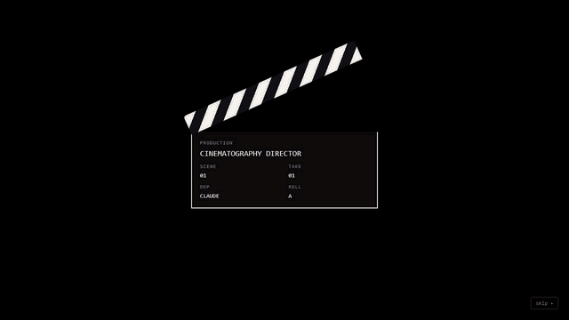

<p align="center">
  <a href="https://jayaprakash-pixel.github.io/cinematography-director/"></a>
</p>

<h1 align="center">Cinematography Director</h1>

<p align="center"><b>Story before spectacle.</b><br>
A Claude Code skill that reads your script like a Director of Photography and decides what the audience sees, how, and when — with a reason for every shot.</p>

<p align="center">
  <a href="https://jayaprakash-pixel.github.io/cinematography-director/"><b>▶ Live page: zoom vs dolly vs dolly zoom, in real 3D</b></a> ·
  <a href="#install">Install</a> ·
  <a href="#how-it-thinks">How it thinks</a> ·
  <a href="#tested">Tested</a> ·
  <a href="LICENSE">Apache-2.0</a>
</p>

<p align="center"><a href="https://jayaprakash-pixel.github.io/cinematography-director/"></a></p>

---

## What it does

Give Claude a script, a narration with word timings, a scene or just an idea. The skill turns it into a **cinematographic blueprint**:

- **Shots**: size, angle, camera height, position, distance, lens. Each one has a reason.
- **Movement**: every move must pass a *motivation gate* (follow, reveal, approach, withdraw, relate, orient, subjective, rhythm). If no motivation applies, the camera stays still.
- **Zoom vs dolly**: never confused. A zoom changes the focal length (the act of looking). A dolly moves the camera (entering the space).
- **Focus**: a timed focus track — what is sharp, when focus moves, for how long, and why.
- **Composition, light and colour**: start and end frames, one colour script for the whole video, and motivated light.
- **Continuity**: scene geography, the 180° line, 30° cuts, eyelines and props.
- **Timing**: a `timeline.json` timed to the words, plus windows where the camera must **hold** for on-screen text.
- **Execution**: instructions for the target you actually have — a real crew, Blender, 2D motion graphics, AI video (Veo, Runway, Kling, Luma) or an editor. If a target cannot do something, the skill names a fallback instead of pretending.

A bundled checker (`scripts/cdcheck.py`, standard-library Python) validates the timeline:
- gaps between shots
- moves without a motivation
- vague words such as "cinematic"
- camera moves during text
- crossings of the 180° line
- instructions the target cannot execute
- shallow-focus and movement budgets

## How it thinks

| # | Step | Output |
|---|---|---|
| 1 | Understand: script, audience, format, tools, intent in your words | brief card |
| 2 | Structure: hook, context, turns, reveal, resolution, anchored on words | beat map |
| 3 | Emotion: dominant + secondary feeling and intensity per beat | emotion timeline |
| 4 | Strategy: what we see, **what stays hidden** and until when, motifs, colour script | info ledger, see/hide list |
| 5 | Shots: every field executable ("85 mm at 1.6 m, f/2.8"), one rejected alternative per key beat | shot list |
| 6 | Timing: start, end, ease, motivation and reason for every event | `timeline.json` |
| 7 | Validate: `cdcheck.py` + continuity checklist | 0 errors |
| 8 | Deliver: crew shot list / Blender keys / 2D camera calls / AI prompts / edit list | production instructions |

**Eight modes**, chosen automatically or by you: Short-form vertical · Long-form · Animation · Personal/travel · Cinematic storytelling · Educational/tech · Commercial/product · Documentary + music video. Each mode has its own priorities and budgets. There is no single house look.

**Eighteen principles** it will not break. Examples:
- no movement without a reason
- shallow focus is budgeted
- distance first, then the lens
- never assume an AI tool obeys every instruction
- never invent facts or sources
- your story stays yours

They are all in [`SKILL.md`](SKILL.md).

## Install

```bash
git clone https://github.com/jayaprakash-pixel/cinematography-director ~/.claude/skills/cinematography-director
python ~/.claude/skills/cinematography-director/scripts/cdcheck.py selftest   # prints "selftest ok"
```

No dependencies. Python 3.8+ is needed only for the checker.

## Use

```text
/cinematography-director shot list for this 30 s Short: script.md, word times in words.json, target: 2D motion graphics
/cinematography-director Blender cameras for this scene (lighthouse.md), 24 fps, real-world metres
/cinematography-director AI video prompts for this documentary scene, Veo; keep the reveal hidden until 1:02
How should I film my travel day in Kyoto with one camera and a gimbal?
```

You get a report that opens with a one-screen **Director's summary**, then the beat map, emotion timeline, visual strategy, shot blueprints, `timeline.json`, validation, production instructions, and "Decisions explained".

## Works with music skills

The timeline has `beats` and `music_hints`. A music skill such as [Scorewright](https://github.com/jayaprakash-pixel/scorewright) can read the same beats as its hit points. There is no dependency between the two skills. The cinematography skill never makes music decisions.

## Tested

The skill was tested on five briefs. Each brief ran in a fresh Claude session with only the skill installed.

| Test | Result |
|---|---|
| 30 s tech Short (2D + AI inserts) | cdcheck 0/0 · 3.73 / 4 |
| 7 min educational video (studio + 3D + Resolve) | cdcheck 0/0 · 3.64 / 4 |
| Personal travel film (APS-C + gimbal) | cdcheck 0/0 · 3.71 / 4 |
| Blender 3D scene, 40 s | cdcheck 0/0 · **camera script executed in Blender 5.2**: 13 cameras, keyed racks and push-in · 3.86 / 4 |
| Suspense documentary, 90 s | cdcheck 0/0 · 3.67 / 4 |

The builder scored these results with [`tests/rubric.md`](tests/rubric.md); it was **not** a blind review. Inputs, full reports, scores and the weaknesses found and fixed are in [`tests/`](tests/).

## Layout

```
SKILL.md            identity, first decision (mode + target), runbook, 18 principles, output contract
core/               decision engine, visual storytelling, visual analysis
camera/             shots & angles, movement & zoom (motivation gate, zoom-or-dolly tree), lens language
focus/  composition/  lighting/  colour/  direction/     one focused file per domain
modes/              m01_shorts ... m08_documentary_music
adapters/           physical_camera, blender, motion_graphics_2d, ai_video (capability matrix), edit_resolve
workflows/          script_to_visuals, scene_to_shotlist, animation, personal video, final audit
templates/          shot blueprint, timeline.schema.json, storyboard, report
references/         cinematographers, film analysis, research sources (34 registered, with reliability)
scripts/cdcheck.py  validator + linter + self-test
```

Claude reads `SKILL.md`. Then it reads only the mode, the adapter and the domain files that the current task needs.

## Known limits

- Reports are thorough, not short (about 25 KB for a 30 s Short). Read the one-screen Director's summary first.
- Claude cannot watch video in real time. It reads frames, contact sheets and timings. Your eyes approve the motion.
- AI video tools change quickly. The capability matrix carries a "checked" date (2026-11-05). Check the tool's current documentation before a production run.
- Some craft numbers (lighting ratios, vertical safe areas) are conventions, and the files label them as conventions.
- Research gaps are listed honestly in [`references/research_sources.md`](references/research_sources.md). For example, Blain Brown's *Cinematography: Theory and Practice* is registered but was not read.

## Licence

[Apache-2.0](LICENSE) © 2026 Jayaprakash, White Noise Academy. Use it, fork it, ship it.

The live page uses [Three.js](https://github.com/mrdoob/three.js) (MIT) and [GSAP](https://gsap.com/) (loaded from a CDN under its own licence). Film and cinematographer references cite their sources and reproduce no copyrighted material.
